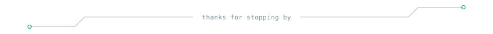

  

  

  I code in <b>C#</b>, <b>Java</b>, <b>Kotlin</b>, <b>Python</b> and <b>JavaScript / React</b>, plan my databases with ERDs and UML, and spend the rest of my time inside a PC case.

  

  
  

  <picture>
    <source media="(prefers-color-scheme: dark)" srcset="./dist/snake-dark.svg">
    <source media="(prefers-color-scheme: light)" srcset="./dist/snake-light.svg">
    
  </picture>

  

